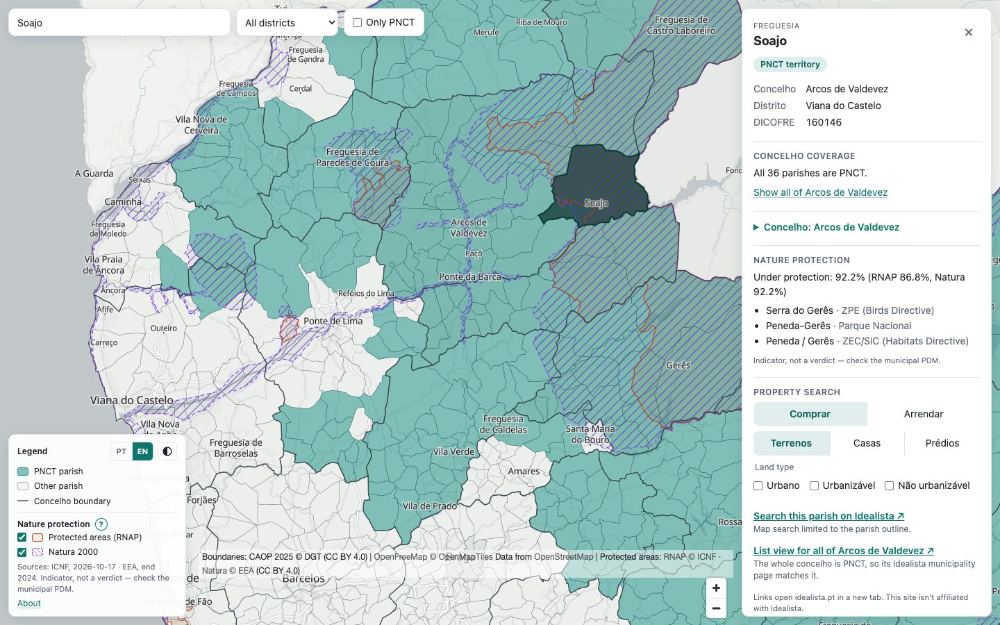

# pnct-map

Interactive map of the parishes in mainland Portugal that the PNCT covers (Programa Nacional para a Coesão Territorial). For each PNCT parish it also builds Idealista property-search links. The links are generated only; nothing ever requests idealista.pt.

Live site: https://pnct.singledev.eu. This is an unofficial tool. What's done and what's next: [docs/ROADMAP.md](docs/ROADMAP.md). Changes: [CHANGELOG.md](CHANGELOG.md).

Features:

- **Parish map:** all 3,049 mainland parishes, with the 1,861 PNCT parishes shaded, and concelho boundaries.
- **Zoom levels:** concelhos (whole / partly / not PNCT) at country zoom, where a click zooms into one; parishes once zoomed in. Zoom-out and panning stop around mainland Portugal.
- **Interaction:** hover tooltip, and a click opens a panel (side panel on desktop, bottom sheet on phones).
- **Search and filters:**
  - Search across parishes and concelhos.
  - A district filter.
  - **Only PNCT** (focus mode): it hides everything outside PNCT territory, and those parishes don't respond to hover, clicks or search.
- **Idealista links:** for each PNCT parish, a polygon search link, with a selector for buying or renting, property type and land filters. When the whole concelho is PNCT, the municipality page is linked too.
- **Concelho card:** every concelho panel shows its population (INE 2025 estimate, the Census 2011→2021 change, density, the ageing ratio) and, for the 185 PNCT concelhos, the câmara's website, mailbox, phone, urbanism page and PDM link. Parish panels have the same card in a collapsed section. A missing value shows "—" with a note, never an estimate.
- **Nature protection:** RNAP (ICNF) and Natura 2000 (EEA) overlays, faded in once zoomed past the country view, and the share of each parish or concelho under protection in its panel. A "?" next to the legend heading explains what protection means for buying land.
- **Português / English:** a PT | EN toggle in the legend header switches every UI string in place, and the basemap labels where OpenStreetMap has a name in that language. Parish and concelho names stay as they are. On first visit the language follows `?lang=`, then the saved choice, then the browser languages (any `pt*` → PT), then English.
- **Light, dark or automatic theme:** a theme button next to the language toggle cycles Auto (follows the system, live) → Light → Dark. The page and the basemap start in the chosen theme, with no flash.
- **Shareable views:** the map view, the selection, the filters and the selector all live in the URL (see [URL parameters](#url-parameters)).



The screenshot is generated with `npm run shots:readme` (in `web/`, with `npm run preview` running).

## Quick start (map only)

The built map data is committed in `web/data/`, so the web app runs without the Python pipeline.

```sh
git clone https://github.com/singledev-eu/pnct-map.git
cd pnct-map/web
npm ci
npm run dev        # Vite dev server, prints the local URL
```

- `npm run build` type-checks and builds the static site into `web/dist/`.
- `npm run preview` serves the built site on http://localhost:4173/ (run `npm run build` first).

## Prerequisites

| Tool | Needed for | Notes |
|---|---|---|
| Node.js 24 and npm | Web app, tests, deploy | Also provides `npx`, which runs mapshaper and wrangler. Developed on Node 24; Vite 8 itself needs Node 20.19+ or 22.12+. |
| [uv](https://docs.astral.sh/uv/) | Data pipeline, pytest | Provides Python 3.12 (`.python-version`, `requires-python` in `pyproject.toml`). |
| make, curl, unzip, shasum | Data pipeline | `make download` uses curl, shasum and unzip. |
| Playwright Chromium | e2e tests, `scripts/perf.mjs` | See below. |

Playwright's Chromium is not installed by `npm ci`. Install it once, into `web/node_modules`:

```sh
cd web
PLAYWRIGHT_BROWSERS_PATH=0 npx playwright install chromium
```

The `test:e2e` and `test:e2e:remote` scripts and `scripts/perf.mjs` set `PLAYWRIGHT_BROWSERS_PATH=0` themselves, so they look for the browser in `node_modules`. The same variable must be set for the install, or the browser goes to the global cache and the tests will not find it.

npm's cache is `../.npm-cache` (set in `web/.npmrc`), so installs stay inside the project.

## Data pipeline

Only needed to rebuild the data from the sources.

```sh
uv sync
uv run make all      # download (checksum-verified) → parse → match → geo → topo → shapes → outline → protected → concelhos → pytest
```

`make download` fetches two sources. Each download is checked against a SHA-256 before it is kept:

- The CAOP 2025 Continente GeoPackage (a 106 MB zip, unpacked) into `data/external/`. It downloads only the 2025 edition.
- The PNCT list PDF from IEFP into `data/raw/`.

Git ignores both downloads. `make all` runs the download as a dependency, so you do not need to call it first.

The protected-areas step also downloads, once, into `data/external/protected/` (gitignored):
- the ICNF RNAP layer, paged from the ArcGIS service (~7 MB);
- the EEA Natura 2000 end-2024 GeoPackage (1.36 GB, EU-wide, SHA-256 pinned).

The concelho step fetches the INE indicators once into `data/external/ine/` (gitignored). `make concelhos-fetch` re-fetches them (`REFRESH=1` replaces the cache, e.g. for next year's estimates). The câmara contacts are curated by hand in `data/contacts/camaras.csv`; `make concelhos` stops on a row that fails `scripts/validate_contacts.py`.

`make protected-fetch` re-fetches them on demand (`REFRESH=1` downloads the GeoPackage again); `cd web && npm run data:protected` does the same plus the rebuild. Which source feeds which category is set in `scripts/protected_config.py`. See [data/ATTRIBUTION.md](data/ATTRIBUTION.md).

| Target | What it does |
|---|---|
| `make download` | Fetches the CAOP 2025 Continente GeoPackage into `data/external/` and the PNCT PDF into `data/raw/`, and verifies both SHA-256 values |
| `make parse` | `scripts/parse_pdf.py` → `data/interim/pnct_raw.csv` |
| `make match` | `scripts/build_parishes.py` → `data/processed/pnct_parishes.csv`, `data/processed/unmatched.csv` |
| `make geo` | `scripts/build_geo.py` → `data/processed/parishes_all.geojson`, `data/processed/concelhos.geojson` |
| `make web-data` | `scripts/build_topo.py` → `web/data/pnct.topo.json` (one TopoJSON, objects `parishes` + `concelhos`; concelhos are dissolved from the simplified parishes on `dicofre[:4]` and carry `pnct_count`/`parish_count`, from which the app derives full/partial/none) |
| `make shapes` | `scripts/build_shapes.py` → `web/data/shapes.json` (one search polygon per PNCT parish) and `data/processed/shapes_quality.csv` |
| `make outline` | `scripts/build_outline.py` → `web/data/outline.json` (the camera outline) |
| `make protected-fetch` | `scripts/fetch_protected.py` → `data/external/protected/<source>/` plus `fetch.json` (source URL, licence, fetch time) |
| `make protected` | `scripts/build_protected.py` → `web/data/protected.topo.json` (display overlay), `web/data/protection.json` (shares per DICOFRE/DICO), `web/data/protected.meta.json` (categories, bundled), `data/processed/protected_sites.csv` |
| `make concelhos-fetch` | `scripts/fetch_ine.py` → `data/external/ine/` plus `fetch.json` (INE population estimates, ageing index, Censuses 2011/2021) |
| `make concelhos` | `scripts/build_concelhos.py` → `data/concelhos.json` (with the curators' notes) and `web/data/concelhos.json` (population and contacts per DICO, loaded on the first concelho card) |
| `make test` | `pytest` (`tests/test_pipeline.py`, `tests/test_shapes.py`, `tests/test_outline.py`, `tests/test_protected.py`, `tests/test_fetch_protected.py`, `tests/test_concelhos.py`) |
| `make web` | `npm ci && npm test && npm run build` in `web/` → static `web/dist/` |
| `make e2e` | `npm ci`, builds, then runs the Playwright e2e suite (`web/tests/e2e`). Screenshots go to `web/test-results/screenshots/` (ignored by git) |
| `make clean` | Removes `data/interim`, `data/processed` and `web/data` |

mapshaper runs through `npx` at a pinned version (`mapshaper@0.7.68`), with its npm cache in `./.npm-cache`.

Committed outputs:

- `web/data/*.json` (`pnct.topo.json`, `shapes.json`, `outline.json`, `protected.topo.json`, `protection.json`, `protected.meta.json`, `concelhos.json`)
- `data/concelhos.json` and `data/contacts/camaras.csv`
- `data/interim/pnct_raw.csv`
- `data/processed/*.csv` (`pnct_parishes.csv`, `unmatched.csv`, `shapes_quality.csv`, `protected_sites.csv`)

Not committed (ignored, rebuilt by `make`):

- `data/processed/*.geojson`
- `data/interim/parishes_full_4326.geojson`, `data/interim/protected/`
- `data/external/` and `data/raw/*.pdf`

`make clean` deletes `web/data`, which the site needs, and the committed CSV files. Run `uv run make all` afterwards to regenerate them. (`git restore web/data data/interim data/processed` also brings the committed files back, but not the ignored GeoJSON files.)

## Tests

| Command | What it runs |
|---|---|
| `uv run pytest -q` | Pipeline, shape, protected-area and concelho-data tests in `tests/`. They read `data/processed/*.geojson`, so on a fresh clone run `uv run make all` first. |
| `cd web && npm test` | Vitest: the polyline codec, the shapes, the link snapshot, camera, layers and theme, the concelho card, PT/EN key parity and the UI-text guard. |
| `cd web && npm run test:e2e` | Builds, then runs the Playwright e2e suite (both languages, both themes, desktop and 375 px phone with emulated iPhone insets) against a local preview server on port 4173. |
| `cd web && npm run test:all` | pytest, Vitest and e2e, in that order. |
| `cd web && E2E_BASE_URL=https://pnct.singledev.eu/ npm run test:e2e:remote` | The e2e suite against a deployed site. |

The link snapshot is `web/src/__snapshots__/links.sha256.json`. It holds a SHA-256 for every Idealista link the panel can show. It must stay at 0 differences. If a link change is intended, update it deliberately with `npx vitest run -u` (from `web/`) and review the diff.

Playwright retries a failed test once. A test that passes only on the retry is reported as **flaky**: `npm run test:e2e`, `test:e2e:remote` and `deploy` then print a yellow warning with the first error and a `npx playwright show-trace …` command. It doesn't block a deploy, but a test that fails both attempts does. The e2e tests wait for the parish layer (`tests/e2e/helpers.ts`), not the basemap, except for screenshots. To check that, `E2E_SLOW_BASEMAP_MS=4000 npm run test:e2e` delays every tiles.openfreemap.org request by up to 4 s.

For throttled load timing, start the preview server (`npm run preview` in one terminal), then run `node scripts/perf.mjs` from `web/` in another. Results from earlier runs are in `docs/perf/`.

## Deploy

Live at https://pnct.singledev.eu (Pages project `pnct-map`, production branch `main`, direct upload).

- `cd web && npm run deploy` runs pytest, Vitest and e2e, builds, then deploys to production.
- `npm run deploy:preview` does the same but deploys to https://preview.pnct-map.pages.dev.
- `E2E_BASE_URL=https://pnct.singledev.eu/ npm run test:e2e:remote` runs the e2e suite against a deployed site.
- Wrangler runs through `npx` at a pinned version. Log in once with `npx -y wrangler@4.149.0 login`.
- The deploy needs no Python pipeline or source data, but its pytest step reads the local pipeline outputs in `data/processed/`. On a fresh clone, run `uv run make all` first.
- `web/public/_headers` sets the caching and security headers. Everything under `/assets/` (including both data files) is content-hashed and cached as immutable.

## Data and attribution

This text matches the About panel on the site, plus the concelho card's own source lines.

- **PNCT territories:** the official list dated 4 February 2026, published by IEFP: https://www.iefp.pt/documents/10181/4287418/Territorios+PNCT_04-02-2026.pdf
- **Boundaries:** CAOP 2025 © Direção-Geral do Território, [CC BY 4.0](https://creativecommons.org/licenses/by/4.0/). "Informação geográfica cedida pela Direção-Geral do Território." Simplified for the web. Landing page: https://www.dgterritorio.gov.pt/cartografia/cartografia-tematica/caop
- **Basemap:** [OpenFreeMap](https://openfreemap.org), © OpenMapTiles, © OpenStreetMap contributors (ODbL).
- **Population (concelho card):** INE, population estimates 2025 and Censuses 2011/2021, [CC BY 4.0](https://creativecommons.org/licenses/by/4.0/). Câmara contacts are from each câmara's website. Both are credited in the card itself.
- **Protected areas:** RNAP © ICNF (reuse terms not confirmed yet), fetched 2026-10-17; Natura 2000 end-2024 © EEA, [CC BY 4.0](https://creativecommons.org/licenses/by/4.0/). The overlay and the "under protection" shares are an indicator, not a verdict: check the municipal PDM. Details and licence status: [data/ATTRIBUTION.md](data/ATTRIBUTION.md).
- **Unofficial tool.** Always confirm eligibility with the official sources. This project is not affiliated with Idealista.

| Source | Edition | URL | Downloaded |
|---|---|---|---|
| PNCT territories list | IEFP, "Lista dos territórios PNCT", PDF dated 2026-02-04 (5 pages) | https://www.iefp.pt/documents/10181/4287418/Territorios+PNCT_04-02-2026.pdf (SHA-256 `c286ef77…e7cffc`). Not committed; `make download` saves it as `data/raw/territorios-pnct-2026-02-04.pdf` | provided; identical to the IEFP file |
| CAOP – Carta Administrativa Oficial de Portugal, DGT, Continente | **CAOP 2025** (approved 2026-01-28; Aviso n.º 3502/2026/2, DR 2.ª série, 2026-02-18), GeoPackage, layer `cont_freguesias`, EPSG:3763 | https://geo2.dgterritorio.gov.pt/caop/CAOP_Continente_2025-gpkg.zip (SHA-256 `87cd67f4…3ecd1d`) | 2026-10-11 |

CAOP is licensed CC-BY-4.0. More background is in `docs/caop_research.md`.

## Licence

The code is under the MIT licence (see `LICENSE`). The data keeps its own licences, listed above.

## Project docs

- `docs/ROADMAP.md`: what's done, what's next, the backlog, past decisions and open items.
- `CHANGELOG.md`: releases.
- `CLAUDE.md`: starting context for Claude Code sessions (commands, invariants, conventions).
- `docs/i18n-glossary.md`: the EN → PT terms and the European-Portuguese conventions for UI text.
- `data/ATTRIBUTION.md`: every data source with its licence status.
- `docs/reports/`: one report per task. The list below covers the early ones; [docs/ROADMAP.md](docs/ROADMAP.md) links every report since.

- `docs/reports/phase1-pipeline.md`: the data pipeline, and why CAOP 2025 was chosen over 2024.
- `docs/reports/phase2-map.md`: the map UI, with test results.
- `docs/reports/phase3-idealista-links.md`: the Idealista search shapes and link builder.
- `docs/reports/perf-initial-load.md`: initial-load performance, with before and after timings.
- `docs/reports/deploy-cloudflare.md`: the Cloudflare Pages deploy and the checks run on production.
- `docs/reports/github-publish.md`: repo cleanup, history rewrite and the first push to GitHub.
- `docs/reports/focus-mode.md`: the "Only PNCT" focus mode: behaviour, URL handling, tests and toggle timing.
- `docs/reports/mobile-attribution.md`: keeping the map attribution clear of the legend on phones.
- `docs/reports/e2e-flakiness.md`: e2e retries and the flaky-test warning, and waiting for the parish layer instead of the basemap.
- `docs/reports/session-2026-10-12.md`: end-of-day state check, the v0.1.0 release, and the first step for the next session.
- `docs/caop_research.md`: research on CAOP editions, download URLs and the 2025 parish split.
- `docs/link-samples.md`: Idealista link samples for manual checking. Regenerate with `uv run python scripts/link_samples.py`.
- `docs/perf/`: load-timing JSON files (baseline, after, production, Cloudflare preview) and side-by-side comparison sheets in `docs/perf/screenshots/compare/`.

## Reference

### CAOP edition and the U.F. split

Lei n.º 25-A/2025 restored 302 parishes from 135 *uniões de freguesias*, effective from the 12 Oct 2025 local elections. DGT published three relevant Continente editions:

| Edition | Parishes | State |
|---|---|---|
| CAOP 2024 | 2882 | pre-split |
| CAOP 2024.1 (extraordinary, Aug 2025) | 3049 | post-split |
| CAOP 2025 | 3049 | post-split; same codes and names as 2024.1 |

We expected the list to follow CAOP 2024, but **the list was written for the post-split map**. 18 of the 83 explicit rows name restored parishes that do not exist in CAOP 2024:

- Águeda: Agadão, Belazaima do Chão, Castanheira do Vouga
- Castelo de Paiva: Raiva, Pedorido, Paraíso
- Loulé: Querença, Tôr, Benafim
- Ourém: Matas, Cercal, Rio de Couros, Casal dos Bernardos
- Tomar: Serra, Junceira
- Ponte de Lima: Gaifar, Sandiães, Vilar das Almas

Every "U.F." name that the list still uses belongs to a union that was *not* split, and all of them exist unchanged in CAOP 2025.

**Decision: match against CAOP 2025.**

- All 83 explicit rows resolve within their own municipality, so no U.F. needs to be mapped onto successor parishes and no rows are flagged for it.
- Against CAOP 2024, exactly those 18 rows fail to match. In 2024 each of them is only part of a larger union, such as `010123` "U.F. de Belazaima do Chão, Castanheira do Vouga e Agadão", so a pre-split map could not show them.
- Wildcard rows (whole district or whole municipality) are expanded using the CAOP 2025 parish set.

### Matching rules (`scripts/build_parishes.py`)

- Each row is matched only within its own municipality, which is resolved from district plus concelho. Rows are never matched across municipalities.
- The match methods are tried in this order:
  1. `override`: a row pin from `data/overrides.csv`.
  2. `exact`: case-insensitive comparison with accents kept.
  3. `normalized`: accents stripped, uppercased, whitespace collapsed, and `U.F. [DE]` / `UNIÃO DAS FREGUESIAS DE` removed. Compared against both `freguesia` and `designacao_simplificada`.
  4. `fuzzy`: rapidfuzz, accepted only if the score is ≥ 90 and at least 5 points clear of the runner-up.
- Anything else goes to `data/processed/unmatched.csv` together with its top 3 candidates.
- Wildcards produce `match_method = wildcard`.

`data/overrides.csv` holds the manual fixes:

- `freguesia = *` is a concelho alias.
- Otherwise the row pins a PDF row to one or more dicofres (separated by `;`).
- A stale override, or a pin that targets an unknown or wrong-municipality code, fails the build.

Known PDF quirks:

- **Duplicate line:** "São Pedro do Sul / todas" appears twice. `parse_pdf.py` drops the duplicate.
- **CASTANHEIRA DE PERA:** officially Castanheira de Pêra. Handled by a concelho alias. Accent stripping would also match it.
- **VÁRZEA, ALIVIADA E FOLHADA (Marco de Canaveses):** pinned to `130740`. In CAOP 2025 this is also the official name, without a "União das freguesias de" prefix.
- **VILAR ALMAS (Ponte de Lima):** pinned to `160763` Vilar das Almas. The fuzzy score was 84.6, below 90, so it was not accepted automatically.

### Outputs

- `data/processed/pnct_parishes.csv`: one row per PNCT parish, with columns `dicofre, distrito, concelho, freguesia_official, source_row, match_method, match_score`.
- `data/processed/parishes_all.geojson`: all 3049 mainland parishes.
  - Properties: `dicofre, freguesia, concelho, distrito, pnct` (bool).
  - EPSG:4326, 5-decimal precision, about 4.7 MB.
  - Simplified with mapshaper (`-simplify 6% keep-shapes`).
- `data/processed/concelhos.geojson`: 278 municipality outlines. They are dissolved from the simplified parishes, so the borders line up exactly.

### Web app (`web/`)

```sh
cd web
npm ci
npm run dev                        # local dev server
npm run build                      # type-check + static build into web/dist/
BASE_PATH=/pnct-map/ npm run build # build for a sub-path, e.g. GitHub Pages
npm run test:e2e                   # build + Playwright e2e tests
```

- **Base path:** the default is `/` (the site is served from the domain root). Set `BASE_PATH` for a sub-path build.
- **Static data:** there is no backend. The app reads `web/data/`, which Vite content-hashes into `/assets/`:
  - `pnct.topo.json` (preloaded) and `outline.json` / `protected.meta.json` (bundled);
  - `shapes.json` (when the first PNCT panel opens), `protection.json` (the first panel), `protected.topo.json` (the first overlay toggle) and `concelhos.json` (the first concelho card).

  The basemap is OpenFreeMap "positron" (light) or "dark".
- **Shareable state:** the URL hash holds the view; see [URL parameters](#url-parameters).
- **Property search:**
  - `src/links.ts` `getLinks(parish, concelho, options)` lazy-loads `data/shapes.json` on first use and caches it.
  - It returns `{label, url, description?, note?}` links: an Idealista polygon search for the parish, plus the municipality page when the whole concelho is PNCT.
  - The selector (Comprar/Arrendar, Terrenos/Casas/Prédios, land filters) persists in the hash (`op`, `t`, `land`) and in localStorage.
  - Unit tests: `npm test` (Vitest).

- **Language and theme:** PT wording follows [docs/i18n-glossary.md](docs/i18n-glossary.md). Every UI string is in `src/strings.en.ts` and `src/strings.pt.ts` (same `Strings` type, so a missing key doesn't compile); `index.html` has no text of its own, only `data-i18n` keys. `src/ui-text.guard.test.ts` fails on UI-looking literals elsewhere. The theme choice (`pnct-map:theme`) is applied by an inline boot script in `index.html` before the CSS; its SHA-256 is in the CSP in `public/_headers` (checked by `src/i18n.test.ts`), so **editing the boot script means updating that hash**.

#### URL parameters

All state is in the hash, e.g. `https://pnct.singledev.eu/#map=10/41.79/-8.58&f=160763&focus=1`, except the language, which is a query parameter: `?lang=pt` or `?lang=en` (e.g. `https://pnct.singledev.eu/?lang=pt#c=0505`). It overrides the saved choice for that link, and the toggle writes it, so a copied link opens in the same language.

| Parameter | Meaning |
|---|---|
| `map=zoom/lat/lng` | Map view, written by MapLibre after each camera move. Without it, the app frames mainland Portugal, or the selected parish or concelho. |
| `f=<dicofre>` | Selected parish, 6 digits, e.g. `f=170810`. |
| `c=<code>` | Selected concelho, 4 digits, e.g. `c=0808`. |
| `d=<district>` | District filter, e.g. `d=Porto`. |
| `focus=1` | Focus mode ("Only PNCT"). It's turned off, and removed from the URL, when the link targets a parish or concelho it would hide. |
| `pnct=1` | Legacy name for `focus=1`; it's still read and rewritten to `focus=1`. |
| `op=arrendar` | Property-search operation (default `comprar`, which is omitted). |
| `t=casas` / `t=predios` | Property type (default `terrenos`, which is omitted). |
| `land=urbano,urbanizavel,nao-urbanizavel` | Land filters, only for `terrenos`, comma-separated. |

`op`, `t` and `land` are also remembered in `localStorage`; the hash wins when both are set.

### Idealista search shapes

URL format, from manually captured Idealista URLs:

```
https://www.idealista.pt/areas/{comprar|arrendar}-{terrenos|casas|predios}[/com-{filters}]/mapa-google?shape=<escaped "((" + polyline + "))">
```

- **Encoding:** Google Encoded Polyline, precision 1e5, lat/lng order, closed ring.
  - Escaping is `encodeURIComponent` plus `( ) ~ ! * '`.
  - Implemented twice: `scripts/polyline.py` (pipeline) and `web/src/idealista.ts` (app). Both are tested against the same captured fixtures.
  - A Vitest test re-encodes every Python-built shape byte for byte.
- **Shapes:** built from full-resolution CAOP 2025.
  - Single-part parish: its outline.
  - Multipart where every minor part is under 5%: the largest part, unless that drops coverage below 0.95.
  - Otherwise: the convex hull, flagged `approx`.
  - Holes are ignored.
  - Topology-preserving simplification to at most `MAX_VERTICES` = 60 unique points (`--max-vertices`). The build fails if any coverage is below 0.95.
- **Unverified:**
  - The `terreno-nao-urbanizavel` slug.
  - The municipality slug rule beyond Arouca, and the filter position in that URL form.
  - Arrendar + terrenos.
  - Idealista's real vertex limit.
- **Manual checks:** `docs/link-samples.md` (regenerate with `uv run python scripts/link_samples.py`).
