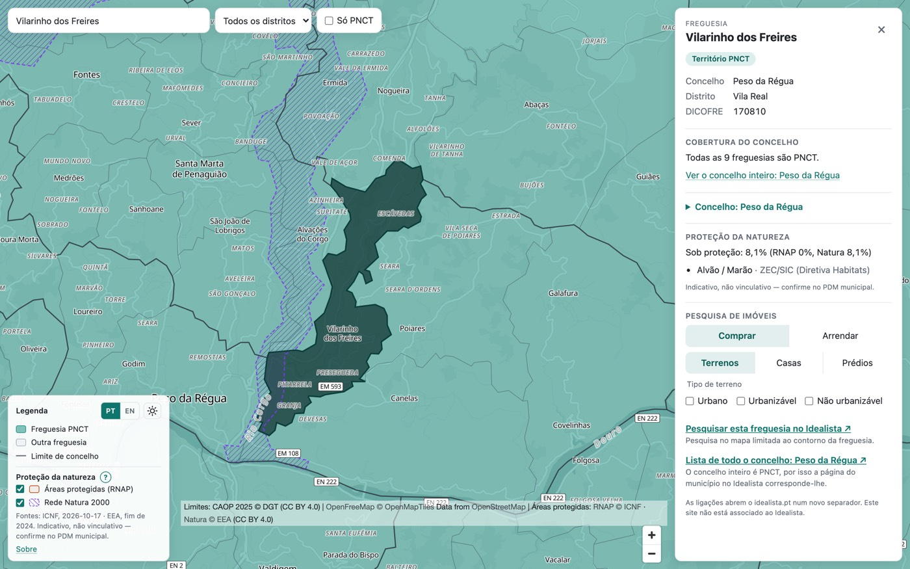
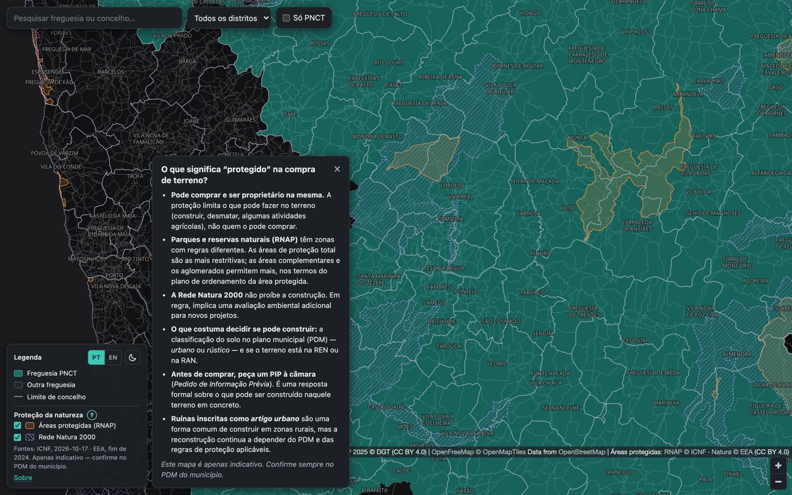
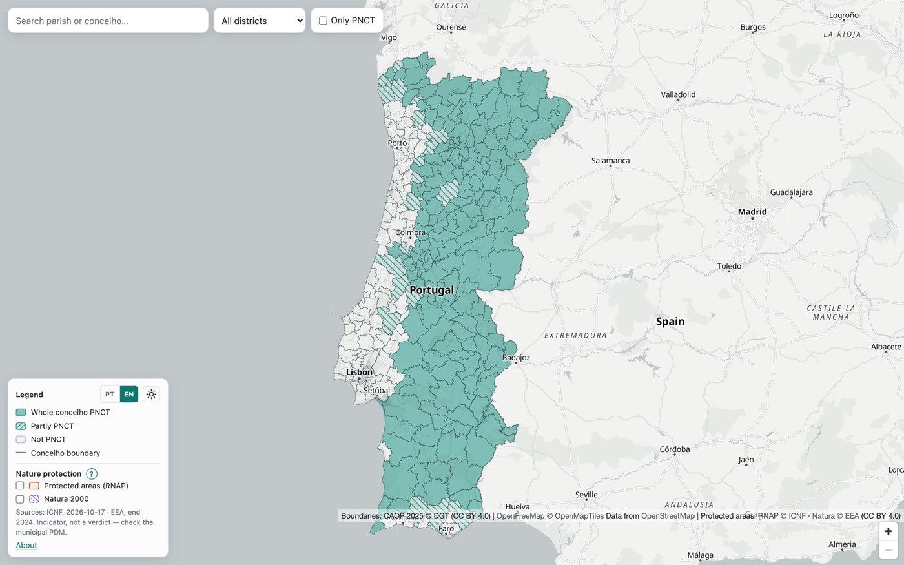
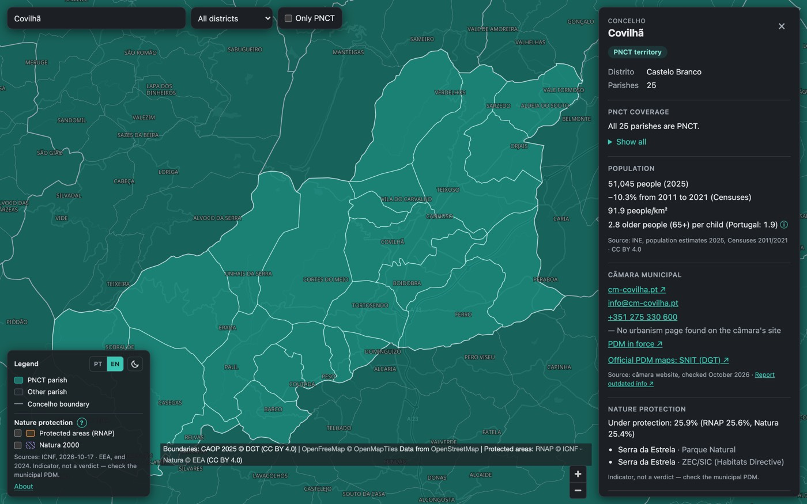
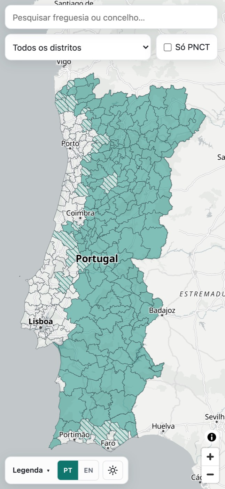
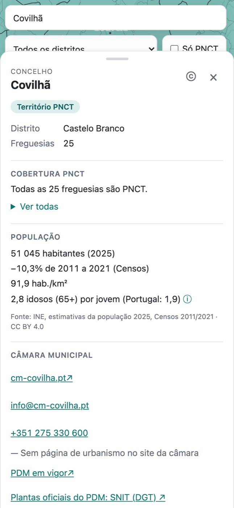
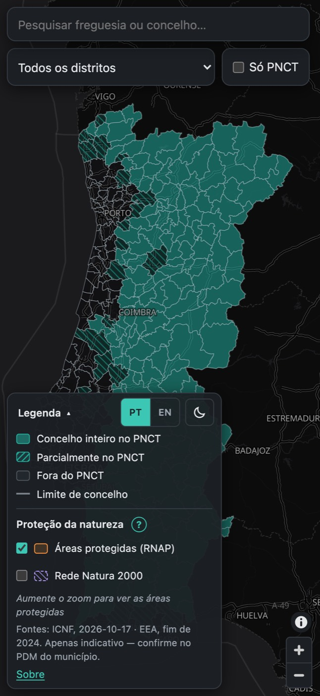
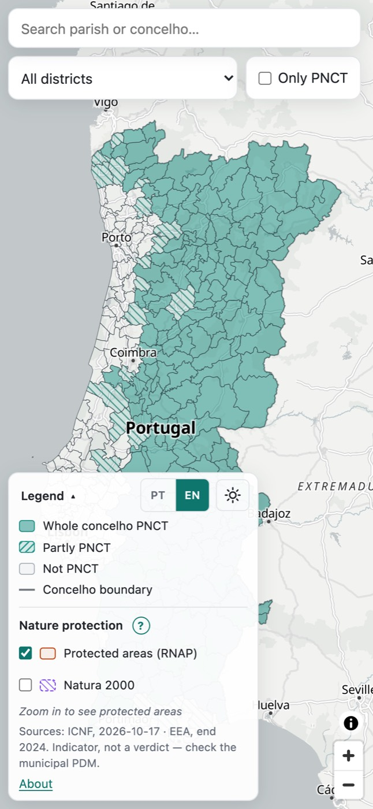
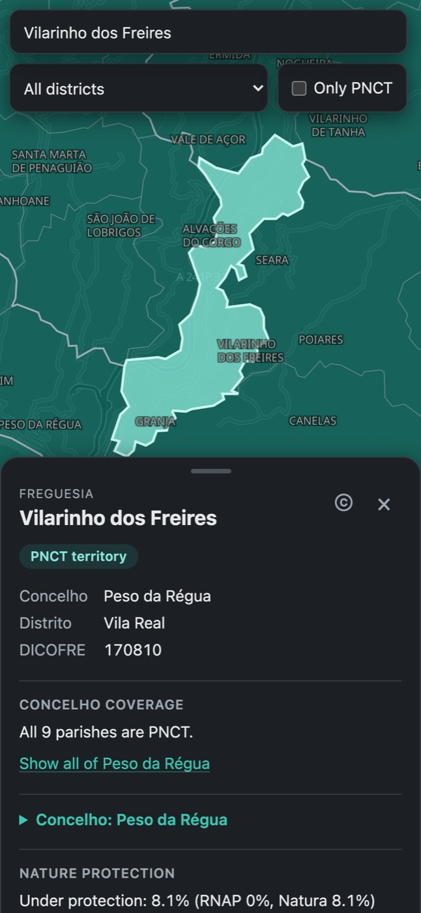

# 0.6.0: PT/EN language toggle and user-selectable theme

Branch `feat/i18n-theme` (commit `a761e5d` plus this report). Not merged, not tagged, not in production.

**Preview:** https://preview.pnct-map.pages.dev (this deploy: https://441b7f8b.pnct-map.pages.dev)

## Summary

- **Language:** the PT | EN toggle switches every UI string in place, with no reload. The camera, selection, overlays, filters and the open panel stay.
  - On load: `?lang=` → saved choice → `navigator.languages` (any `pt*`) → EN.
  - A switch saves the choice and writes `?lang=` with `replaceState`; the `#…` hash is kept.
  - `<html lang>` (`pt-PT` / `en-GB`), the title and the meta description follow the language.
  - Numbers and dates go through `Intl` in the active locale.
- **Theme:** Auto / Light / Dark, default Auto (unchanged behaviour, live).
  - The choice is saved in localStorage; every access is in try/catch, and the page falls back to Auto.
  - An inline boot script in `<head>` sets `data-theme` before the CSS, and `main.ts` creates the map with the matching basemap. There is no flash, and no request for the other style.
- **Controls:** in a new legend header row on desktop. On the phone they sit in the collapsed legend chip, so no panel needs opening.
- **PT translation:** I wrote it myself instead of delegating to kiro-cli. The terminology needed to be consistent with the existing PT terms used in the EN UI, and reviewing a kiro diff of ~200 strings would have taken as long. The glossary is below for your review.

## What changed, file by file

### Web app (`web/`)

| File | Change |
|---|---|
| `src/strings.ts` | Rewritten. Holds the interfaces (`UiStrings` new; `ProtectedStrings`, `ConcelhoStrings`, `SheetStrings`) and the `Strings` aggregate. It exports `STRINGS = { en, pt }` and live bindings (`lang`, `ui`, `t`, `tc`, `sheet`) that `setLang()` swaps. `ISSUE` holds the English-only GitHub issue text. `formatNumber` / `formatPct` are locale-aware. |
| `src/strings.en.ts` | **New.** Every English string. The protected and concelho strings moved here from `strings.ts`; the rest came from `index.html`, `main.ts`, `panel.ts`, `links.ts`, `search.ts` and `concelho.ts`. |
| `src/strings.pt.ts` | **New.** The European Portuguese table, typed `Strings`, so a missing key is a compile error. |
| `src/i18n.ts` | **New.** `detectLang`, `initialLang`, `rememberLang` (localStorage + `?lang=`), `applyStatic` (fills `[data-i18n]` / `[data-i18n-attr]`, `<html lang>`, title, description), `fill` (`{placeholder}` → link) and `rich` (`**strong**`, `*em*`). |
| `src/controls.ts` | **New.** The PT \| EN segmented toggle (`aria-pressed`, names "Português (PT)" / "English (EN)") and the theme button (inline SVG icons; `aria-label` and `title` state the current theme). |
| `src/about.ts` | **New.** The About dialog rendered from strings, with the full linked attribution. It was static HTML before. |
| `src/theme.ts` | Adds `ThemePref`, `nextThemePref`, `resolveTheme`, `loadThemePref` / `saveThemePref` (try/catch, invalid → Auto) and `applyPageTheme` (`data-theme`, `data-theme-pref`, and `theme-color` metas for a forced theme). |
| `src/main.ts` | Sets the language first. Reads the theme choice before creating the map. `applyTheme()` replaces the old OS listener body; the listener now acts only under Auto. Mounts the controls before the data loads. The attribution control is recreated on a language switch. `onLangChange` relabels the legend toggles, rebuilds the search indexes, closes the result list, hides the tooltip and re-renders the panel for the same selection. Tooltip and error strings now come from `ui`. |
| `src/panel.ts`, `links.ts`, `search.ts`, `sheet.ts` | Literals replaced by `ui.*` / `sheet.*`. `search.ts` gains `close()`. |
| `src/legend.ts` | The overlay toggles and the explainer are built once, and `relabel()` re-reads the strings, so state and focus survive a switch. `rich()` now comes from `i18n.ts`. |
| `src/concelho.ts` | Numbers via `formatNumber` and dates via `ui.locale`. The issue body uses `ISSUE` (English in both languages). |
| `src/protected.ts` | `CategoryMeta.pt`. The source "as of", the licence and the Natura designations come from the meta in the active language. |
| `index.html` | Inline theme boot script before any CSS. The `<body>` has no text: every element names a `ui` key (`data-i18n`, `data-i18n-attr`). New legend header: `.legend-header` holds the phone toggle, the desktop `.legend-title` and `#settings`. The head meta tags stay bilingual for crawlers; JS sets the title and description per language. |
| `src/style.css` | Dark tokens on `:root[data-theme="dark"]` (was `@media (prefers-color-scheme: dark)`), with `color-scheme` per theme. The MapLibre dark overrides use the same selector. New styles for the header, the toggle and the theme button: 26 px desktop, 32–34 px phone tap targets, `:focus-visible` rings. |
| `public/_headers` | `script-src 'self' 'sha256-ip+10eBS/…'` for the boot script. |
| `tsconfig.json` | Adds `es2023.intl` (for `useGrouping: "always"`). |
| `scripts/i18n_shots.mjs` | **New.** Review shots: desktop and 375 px phone × PT/EN × light/dark × 4 views. The theme is forced against the opposite system scheme. |
| `package.json` | 0.6.0. |

### Pipeline

| File | Change |
|---|---|
| `scripts/protected_config.py` | Adds `PtLabels` (title, release, licence, types) on each source. Natura gets `fim de 2024` and `ZPE (Diretiva Aves)` / `ZEC/SIC (Diretiva Habitats)` / `ZPE + ZEC (ambas as Diretivas)`. The unconfirmed licence gets `Condições de reutilização não confirmadas`. RNAP designations are already Portuguese. |
| `scripts/build_protected.py` | `pt_meta()` writes a `pt` block per category into `protected.meta.json` only. |
| `web/data/protected.meta.json` | Rebuilt: +20 lines, 1 KB raw. `protected.topo.json` and `protection.json` are byte-identical. |

### Tests and docs

- New: `web/src/i18n.test.ts`, `web/src/ui-text.guard.test.ts`, `web/tests/e2e/i18n-theme.spec.ts`. Updated: `web/src/theme.test.ts` (selector), `tests/test_protected.py`.
- `README.md`: features, the language/theme note, and `?lang=` in URL parameters.
- `CHANGELOG.md`: 0.6.0 entry, marked unreleased.
- `docs/ROADMAP.md`: Next → 0.6.0 on preview; the backlog line removed.
- `CLAUDE.md`: new modules, plus two invariants (UI text only in the strings files; the boot script hash).

## Controls: where and why

**Desktop:** a header row at the top of the legend, with "Legend" on the left and `PT | EN` plus the theme button on the right.

**Phone:** the same row is the collapsed legend chip, `[Legenda ▾] [PT|EN] [☀]`, about 250 px wide at 375 px. Both controls are reachable without opening anything. When a parish/concelho sheet is open, the legend is hidden (as before), so the controls are one × away.

This is your proposal, with one adjustment: on the phone the controls are in the chip itself, not inside the expanded legend. Otherwise they would need a tap to open first. I didn't use the toolbar: on a 375 px phone it already wraps to two rows (search, then district + Só PNCT), and a third item would push it to three.

Theme icons: half-filled circle (Auto), sun (Light), moon (Dark). They're SVG, not emoji, so iOS doesn't render a colour ☀️.

| | Light | Dark |
|---|---|---|
| Desktop PT |  |  |
| Desktop EN |  |  |
| Phone PT |   |  |
| Phone EN |  |  |

All 32 shots (`npm run preview`, then `node scripts/i18n_shots.mjs <dir>`) are in the gitignored `.artifacts/i18n/`. The e2e phone test also saves `web/test-results/phone-pt-legend.png` and `phone-pt-card.png`.

## Glossary (EN → PT) for review

| # | EN | PT |
|---|---|---|
| 1 | parish | freguesia |
| 2 | concelho / municipality | concelho (Idealista's page: "município") |
| 3 | district | distrito |
| 4 | Câmara Municipal | Câmara Municipal (in sentences: "a câmara") |
| 5 | PNCT territory (badge) | Território PNCT |
| 6 | Not PNCT | Fora do PNCT |
| 7 | Only PNCT (filter) | Só PNCT |
| 8 | Whole concelho PNCT / Partly PNCT | Concelho inteiro no PNCT / Parcialmente no PNCT |
| 9 | Concelho boundary | Limite de concelho |
| 10 | Legend | Legenda |
| 11 | Concelho coverage / PNCT coverage | Cobertura do concelho / Cobertura PNCT |
| 12 | Property search | Pesquisa de imóveis |
| 13 | Property type / Land type / Operation | Tipo de imóvel / Tipo de terreno / Operação |
| 14 | Search this parish on Idealista | Pesquisar esta freguesia no Idealista |
| 15 | link(s) | ligação / ligações |
| 16 | opens in a new tab | abre num novo separador |
| 17 | Nature protection | Proteção da natureza |
| 18 | Protected areas (RNAP) | Áreas protegidas (RNAP) |
| 19 | Natura 2000 (toggle) | Rede Natura 2000 |
| 20 | Under protection: X% | Sob proteção: X% |
| 21 | Indicator, not a verdict — check the municipal PDM. | Indicativo, não vinculativo — confirme no PDM municipal. |
| 22 | Zoom in to see protected areas | Aproxime o mapa para ver as áreas protegidas |
| 23 | Birds / Habitats Directive | Diretiva Aves / Diretiva Habitats |
| 24 | Population | População |
| 25 | N people (2025) | N habitantes (2025) |
| 26 | people/km² | hab./km² |
| 27 | ageing index | índice de envelhecimento |
| 28 | X older people (65+) per child | X idosos (65+) por jovem |
| 29 | Censuses | Censos |
| 30 | PDM in force / PDM documents | PDM em vigor / Documentos do PDM |
| 31 | Urbanism | Urbanismo |
| 32 | Website | Site |
| 33 | Report outdated info | Comunicar informação desatualizada |
| 34 | Official PDM maps: SNIT (DGT) | Plantas oficiais do PDM: SNIT (DGT) |
| 35 | Boundaries / Basemap | Limites / Mapa de base |
| 36 | © OpenStreetMap contributors | © colaboradores do OpenStreetMap |
| 37 | reuse terms not confirmed | condições de reutilização não confirmadas |
| 38 | Theme: Auto (system) / Light / Dark | Tema: automático (sistema) / claro / escuro |
| 39 | Language | Idioma |
| 40 | Expand / Collapse panel | Expandir / Recolher painel |

### Strings I'm unsure about

- **"por jovem"** for the ageing ratio. INE's definition counts 0–14 as "jovens", so "4,2 idosos (65+) por jovem" is accurate. "por criança" reads more naturally to some people.
- **"Indicativo, não vinculativo"** for "Indicator, not a verdict". "Vinculativo" (binding) is the usual legal register; a plainer alternative is "Apenas indicativo — confirme no PDM municipal."
- **Explainer, RNAP item:** "As áreas de proteção total são as mais restritivas; as áreas complementares e os aglomerados permitem mais, nos termos do plano de ordenamento da área protegida." Since the 2015 reform these plans are formally "programas especiais"; I kept "plano de ordenamento" as the familiar term.
- **"Site"** vs "Sítio" / "Página oficial" for the câmara website. "Site" is the common usage in Portugal.
- **"Aproxime o mapa"** for "Zoom in". The alternative is "Amplie o mapa".
- **Sentences that avoid "de + place name".** PT coverage lines say "do concelho" instead of naming it ("Nenhuma freguesia do concelho é PNCT"), so "de Porto" / "do Porto" contractions can't go wrong. The name is in the panel title. The same applies to "Ver o concelho inteiro: Peso da Régua" and "Lista de todo o concelho: X".
- **Kept in Portuguese in EN, as before:** Comprar/Arrendar, Terrenos/Casas/Prédios, Urbano/Urbanizável/Não urbanizável (Idealista's own terms), "Freguesia"/"Concelho" kickers and search tags, "Distrito", and the RNAP designations from ICNF (e.g. "Parque Natural"). ICNF's data spells "Area Protegida Privada" without the accent; I left the data as is.
- **Basemap place labels** ("Lisbon", "Seville") come from OpenFreeMap's `name:latin` and don't follow the toggle. Out of scope; it would need a per-language label patch in `basemap.ts`.

## Text that wasn't in `strings.ts` before

`strings.ts` held only the protected-areas strings, the concelho card and the sheet labels. Everything else was elsewhere:

- **`index.html`:**
  - the map aria-label, the search label and placeholder, "District", "All districts";
  - "Only PNCT" with its title and aria-label;
  - "Legend", the legend's aria-label and its six rows, the overlays group label;
  - "About", "Loading map…";
  - the whole About dialog.
- **`main.ts`:**
  - the tooltip lines ("PNCT: yes/no/all parishes/N of M parishes", "Concelho · district");
  - the search sublabel;
  - the attribution "Boundaries: CAOP 2025 © DGT (CC BY 4.0)";
  - the basemap and map-data error states.
- **`panel.ts`:**
  - kickers, badges, fact labels, coverage sentences, "Show all (of X)", "PNCT parishes";
  - the property-search heading, its fieldset legends and option labels;
  - the loading, empty and error link states, the disclaimer, the non-PNCT message;
  - "Close panel", the sheet credit's "Boundaries".
- **`links.ts`:** the four link labels, descriptions and notes.
- **`search.ts`:** the "Concelho"/"Freguesia" tags, "No matches", " (PNCT)".
- **`concelho.ts`:** the issue-body field names. They moved to `ISSUE`, which stays English.
- **Data meta:** "end 2024" and the Natura designations ("ZPE (Birds Directive)" …) were English-only in the pipeline output. They're now in both languages in `protected.meta.json`.

## Tests

| Suite | Before (0.5.0) | Now | New |
|---|---|---|---|
| pytest | 113 | **114** | PT labels in `protected.meta.json` cover the built designations (and every Natura one) |
| Vitest | 97 | **117** | `i18n.test.ts` (15), `ui-text.guard.test.ts` (5) |
| e2e (Playwright) | 87 | **99** | `i18n-theme.spec.ts` (12) |

- **Full suite:** `npm run test:all` passed twice (before the commit and inside `deploy:preview`), with no flaky tests. The link snapshot has 0 differences: the EN link labels are unchanged.
- **Against the real preview** (Cloudflare headers, CSP included): `E2E_BASE_URL=https://preview.pnct-map.pages.dev/` ran `i18n-theme`, `smoke` and `theme`, 25 passed. The forced-theme tests prove the inline boot script runs under the CSP.
- **Unit:**
  - PT/EN key parity (deep: nested objects, the explainer item array, the per-category maps) and no empty strings;
  - `setLang`;
  - number formats (`8 360`, `4,2`, `12,3%`, `<0,5%`);
  - detection order and invalid values;
  - `fill` for every About template;
  - every `data-i18n` key in `index.html` is a plain-text `ui` key;
  - the boot script's SHA-256 is in `_headers`;
  - the theme cycle, resolution, save/forget, invalid → Auto, broken storage and a throwing accessor;
  - boot script ↔ `theme.ts` parity over 5 stored values × 2 system schemes × broken storage.
- **Guard (`ui-text.guard.test.ts`):** a scanner over every non-test module except the strings files. It flags literals that read like prose: a capitalised word + word, three lowercase words, or "…". It also flags single capitalised words given as UI text (an `h()` child, or assigned to `textContent`/`title`/`placeholder`/`aria-label`). Lines that log or throw are skipped. `index.html` must have no `<body>` text and no text attributes outside `data-i18n-attr`.
  - Checked against the 0.5.0 sources: it flags about 28 strings in `panel`, `links`, `main`, `search` and `concelho`.
  - **Limits:** it misses single words inside objects ("Freguesia" in a lookup table), lowercase single words, text built by concatenation or held in a variable, and short code-like text such as "PNCT: yes". Proper names given as link text ("OpenFreeMap", "CAOP 2025") pass on purpose. Both limits are documented in the file.
- **e2e:**
  - each language renders the page, legend, concelho card and parish panel;
  - `pt-PT` browser locale → PT; the live switch keeps the selection, overlays, hash and camera, and relabels the meta-derived text;
  - the choice persists across reloads and `?lang=` overrides it (the saved choice stays);
  - About in PT lists every credit link;
  - forced dark on a light system and forced light on a dark one: `data-theme` never takes the other value (a MutationObserver from the first document script), only the matching basemap style is requested, and the body background matches;
  - Auto follows an emulated system change while Light/Dark ignore it, and Auto clears the stored value;
  - the theme persists across reloads with the selection kept;
  - storage throwing: the page loads in Auto and both controls work;
  - keyboard: Tab, Enter and Space, focus kept after a switch, a solid focus outline;
  - 375 px phone in PT: the controls are visible in the collapsed chip; no clipping or overflow in the chip, the toolbar, the expanded legend, the sheet header or the card (screenshots saved).
- **Not done:** the existing specs weren't run in PT. They assert English text, so a PT run would fail on wording rather than behaviour. The PT spec covers the same flows (legend, card, panel, overlays, About, phone sheet) in PT.

## What to check on the phone

Preview: https://preview.pnct-map.pages.dev

1. **First visit, phone in Portuguese:** the UI opens in PT. With the phone in English it opens in EN. To retest, clear site data, since the toggle saves the choice.
2. **The legend chip:** `Legenda ▾ | PT EN | ☀`. Check it reads well and doesn't collide with the ⓘ / zoom buttons, both portrait and landscape.
3. **Tap EN / PT with a parish open, then close it:** the map shouldn't move, the panel text should switch, and Safari's address bar should show `?lang=…#f=…`. Share or copy the link and open it in a private tab: same language.
4. **Theme button:** tap through Auto → Light → Dark. Light on a dark phone, and dark on a light one, should load directly in that theme, with no light flash on reload in dark. The Safari toolbar colour should follow a forced theme. Then set Auto and switch the system appearance in Control Centre: the map should follow.
5. **PT layout:** expanded legend (Proteção da natureza, the note), the concelho card at full sheet (Idanha-a-Nova `?lang=pt#c=0505`), and the protection explainer sheet. Look for clipped or awkwardly wrapped labels.
6. **Private browsing (storage limits):** the page should still load and both toggles work for that page.
7. **Read the PT wording** against the glossary above, especially the explainer and the concelho card.

When you're happy: fast-forward `feat/i18n-theme` into `main`, set the CHANGELOG date, tag `v0.6.0` and `npm run deploy`.
