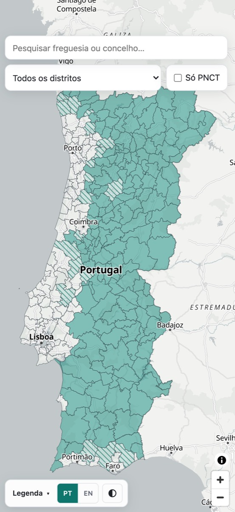
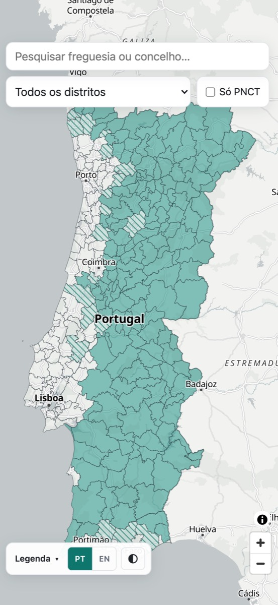
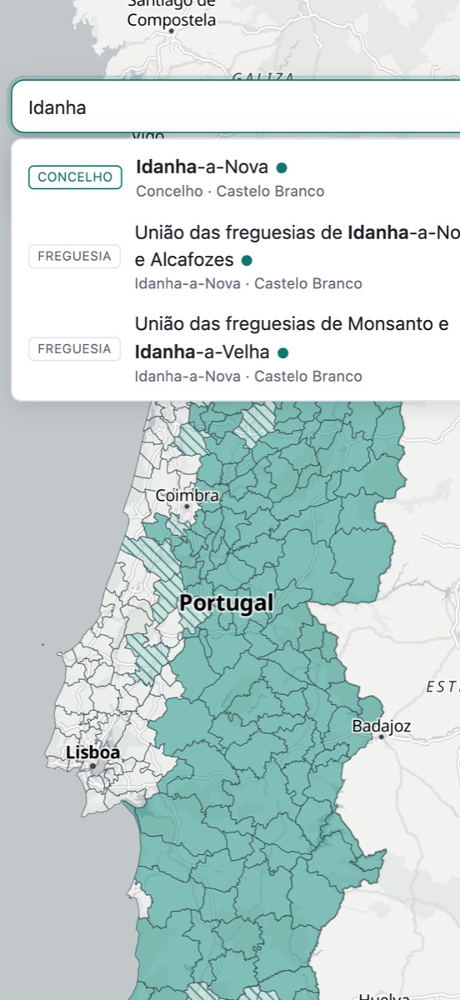
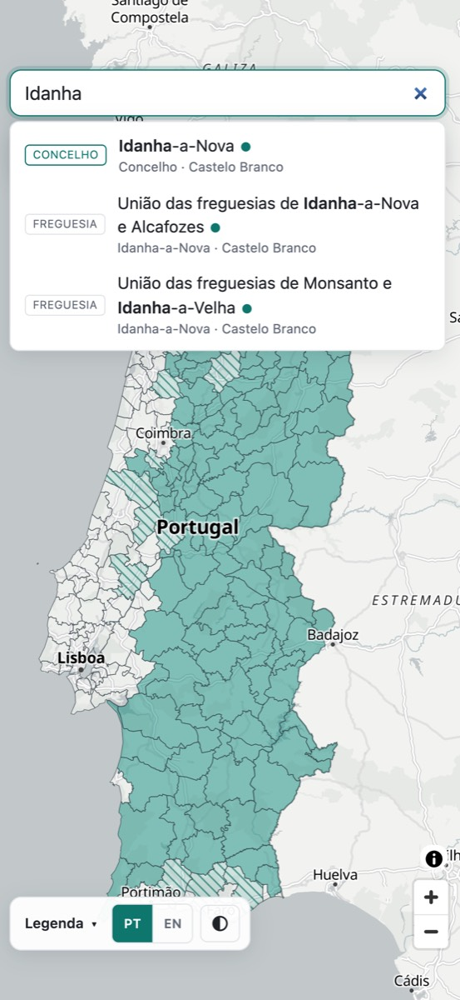
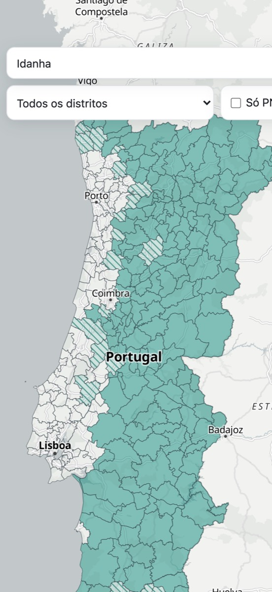
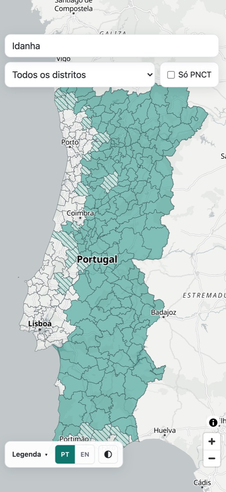
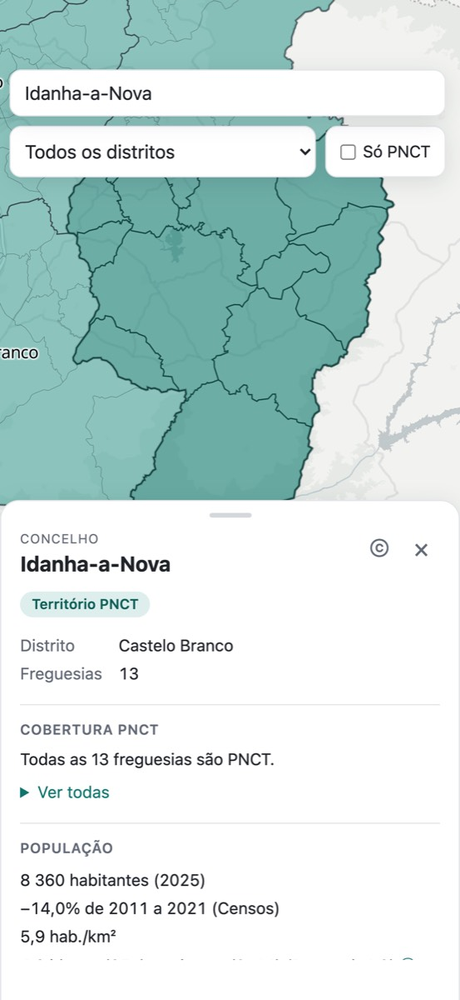
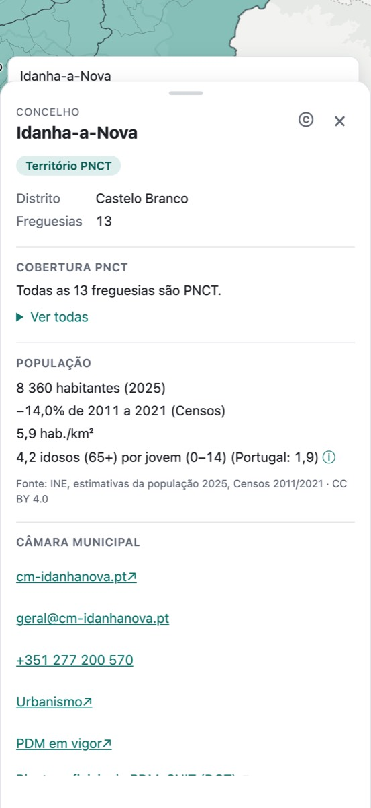
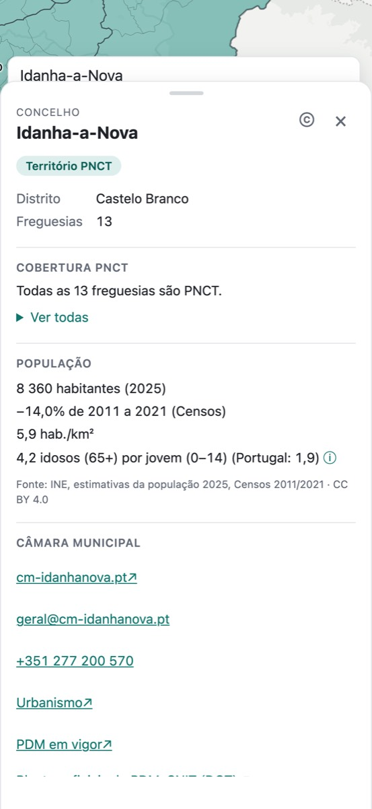

# 0.6.0: iPhone Safari zoom and safe-area fix

Branch `feat/i18n-theme` (`039880a` plus this report). Not merged, not tagged, not in production.

**Preview:** https://preview.pnct-map.pages.dev (this deploy: https://4cf61b5b.pnct-map.pages.dev)

## Cause

- **The zoom:** the search field and the district select inherited the body's 14 px. iOS Safari zooms the page into any focused text control under 16 px (×16/14 ≈ 1.14 here) and doesn't zoom back out on blur. In the zoomed view the right side of the toolbar ("Só PNCT") and the bottom of the page fall outside the screen.
- **The bottom edge:** separately, the legend chip and the map controls sat 8 px from the bottom edge. `viewport-fit=cover` was already set, so that edge is under the home indicator and Safari's floating toolbar.

## Fix (`web/src/style.css`, `search.css`)

1. **16 px text controls:** text inputs, selects and textareas are `font-size: 16px` under `(max-width: 640px), (pointer: coarse)`. The phone toolbar layout is unchanged (same heights). The viewport meta is unchanged: no `maximum-scale` or `user-scalable`, so pinch zoom still works.
2. **Bottom insets:**
   - legend: `bottom: calc(8px + env(safe-area-inset-bottom))`;
   - MapLibre's bottom-right controls (zoom, compact ⓘ): offset by `env(safe-area-inset-bottom)`;
   - the sheet already had `padding-bottom: env(safe-area-inset-bottom)` and keeps it, as does the explainer sheet.
3. **`dvh` heights**, with `vh` fallbacks for older browsers:
   - `html, body`: `100dvh`;
   - sheet snap heights: 50dvh / 90dvh;
   - expanded legend: `100dvh − 150px − top and bottom insets`;
   - explainer: 75dvh on phones, `100dvh − …` on desktop;
   - search list: 60dvh.

   The sheet's drag code caps at `window.innerHeight × 0.9`, which on iOS follows the visible viewport like `dvh`, so the snap heights agree.
4. **Top:** the toolbar already used `max(8px, env(safe-area-inset-top))`. It now also uses `env(safe-area-inset-left/right)` for landscape with the notch at the side.

## Tests

New e2e `web/tests/e2e/mobile-safari.spec.ts` (375×812, `isMobile`), with safe-area insets **emulated** through CDP `Emulation.setSafeAreaInsetsOverride` (top 59, bottom 34, as on an iPhone with a Dynamic Island):

1. Every visible input/select/textarea that takes text has a computed font-size ≥ 16 px, including the search field and the district select. Focusing the search, typing and leaving it changes neither the toolbar's position nor `visualViewport.scale`.
2. The toolbar top is at or below the top inset. The legend chip's bottom edge, the PT/EN and theme controls, and the map controls are all above the bottom inset. The expanded legend fits between both insets.
3. The sheet pads its content by the bottom inset. Half is ≤ 50% of the viewport, full is 85–90%, and it toggles back.

**Non-vacuous:** with the 0.6.0-RC CSS, tests 1 and 2 fail (search 14 px; legend bottom 804 > 778) and test 3 passes. It's a regression guard for the sheet, which already handled its inset.

**Limits:**
- Chromium can't reproduce Safari's focus-zoom itself, so test 1 checks its cause (the font size).
- Safari's floating toolbar can't be emulated, only the safe-area insets that come with `viewport-fit=cover`. The real-device check stays on you.

**Counts:**
- Full suite in `deploy:preview`: pytest 114, Vitest 120, e2e **104** (+3), no flaky tests. The link snapshot has 0 differences.
- Against the preview: `mobile-safari`, `bottom-sheet` and `legend` passed (13).

## Production 0.5.0

**Affected too.** Against https://pnct.singledev.eu, `mobile-safari.spec.ts` fails the same two tests: the search field is 14 px, and the legend chip's bottom (804 px) is inside the 34 px bottom inset. The sheet test passes. The legend chip there has no language/theme controls, but the same focus-zoom and bottom-edge problem applies. Releasing 0.6.0 fixes both.

## Screenshots

Taken by `web/scripts/phone_safe_area_shots.mjs`: a 393×852 iPhone viewport with the emulated insets, PT. In "before", Safari's focus zoom is reproduced by setting the page scale Safari would apply (16/14) and keeping it after blur, as Safari does. In "after" the field is 16 px, so there's no zoom.

| | Before (0.6.0 RC) | After |
|---|---|---|
| Load |  |  |
| Search focused |  |  |
| Search left |  |  |
| Sheet, half |  |  |
| Sheet, full |  |  |

## On the iPhone

1. Tap the search field: no zoom. Type, then tap the map: the toolbar and "Só PNCT" are whole.
2. The legend chip with PT | EN and the theme button sits above Safari's bottom toolbar, in portrait and landscape.
3. Pinch-zoom the page: it still zooms. Double-tap or pinch back.
4. Open a concelho: the sheet at half, then drag to full. The last line clears the home indicator; drag down to half and to close.
5. Expand the legend with the overlays on: it scrolls inside the screen and isn't hidden behind the toolbar.
